# COMP3207 - Installing Development Environment - Lab 1

## Overview

The first four labs prepare you for the first assignment due for COMP3207. This assignment requires you to develop and deploy Python-based Azure functions that implement a predefined API.

Completing this lab is a pre-requisite for all subsequent labs. By the end of this lab, you will be in a position to start coding Azure functions.

Follow the instructions below to ensure your development environment is correctly configured. The final step to setup VS Code is optional.

If you plan on using lab machines, then the software is already installed. You can skip the install steps, but will still need to follow the below instructions to ensure the setup works for you.

## Lab Goals

The goals of this lab are to:

1. Set up [Azure Student Account](##1-azure-student-account) to access Cloud Resources for free
2. Install [Python](##2-installing-python)
3. Install [Azure Function Tools](##3-installing-azure-functions-tools) to enable local development of Cloud Apps
4. (Optionally) Configure MS VS Code

The steps to accomplish all of these goals are listed below.

## 1. Azure Student Account

### Goals

In the first part of this lab we will work with Microsoft Azure Cloud services.

The goal is to set up your student account to get free access to the services we will be using later in this module.

There are two approaches to setting up your Azure student account: either using your *soton.ac.uk* email address (Option 1) or a personal one (Option 2). 

**Most students should use Option 1 (University account).**

We recommend using your University email account as MS will recognise this is an academic account.

Only use Option 2 if Option 1 does not work.

### Option 1 – Using Uni account (Preferred)

Go to https://portal.azure.com and sign in with your Uni credentials

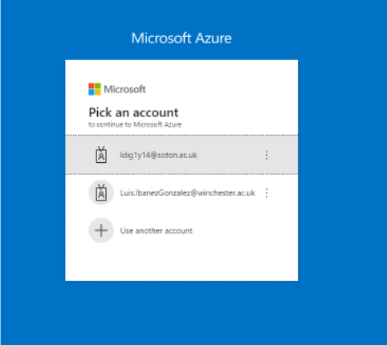

Go to "Subscriptions" Manager
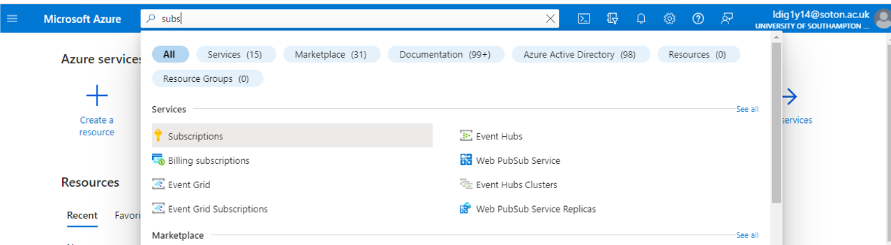

Add new subscription

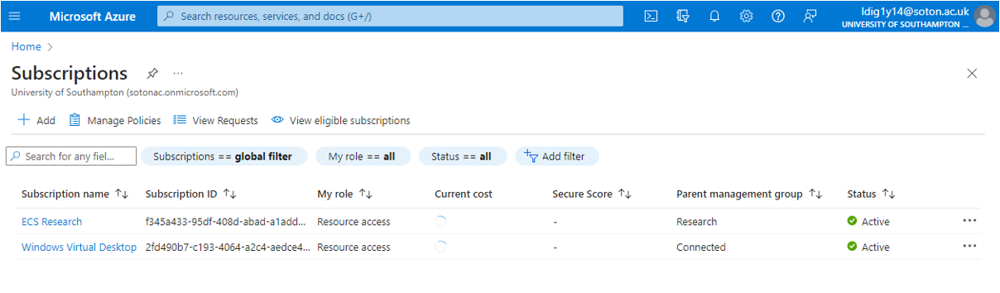

These are the ones managed by the University related to your student account (your OneDrive and other Office365 products). Ignore them, you can't update them anyway

Select Azure for Students

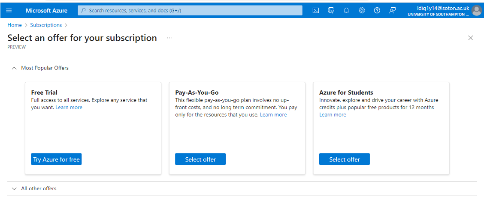

You are redirected to this page

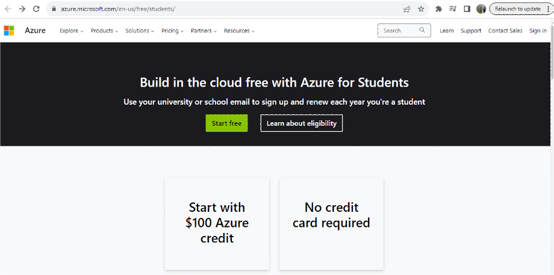

Click on Start Free

Fill verification form

Fill the enrolment form

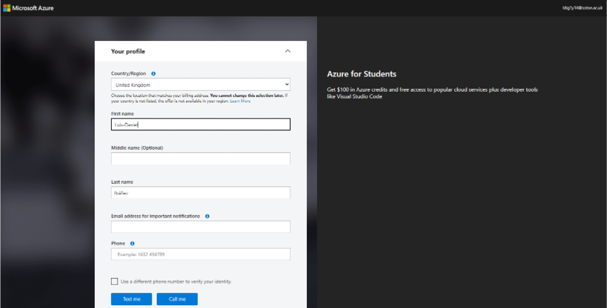

Check "Education" section to verify success, Type "Education" on the search bar and click on the Purple education section

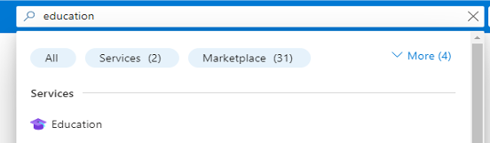

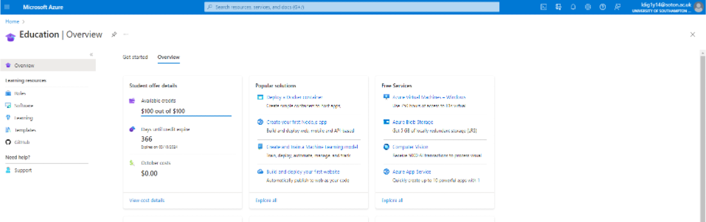

Feel free to explore the admin console, but don't create anything yet

We will introduce the bits we will use later in the module.

- [ ] Successfully registered new account

### Option 2 – Using personal account

Remember, this step is only required if you are unable to use your University @soton.ac.uk email to register for an account. The recommendation is to use your @soton.ac.uk email account.

Go to https://azure.microsoft.com/en-gb/free/students

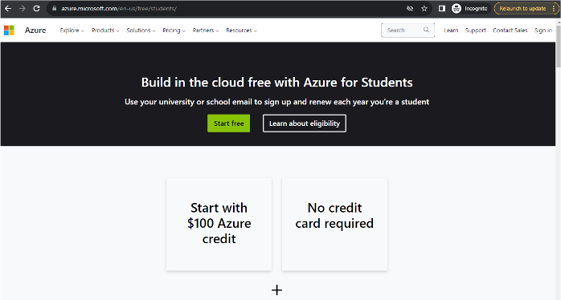

Click on "Start Free"

Use here your personal account (Must be Microsoft linked)

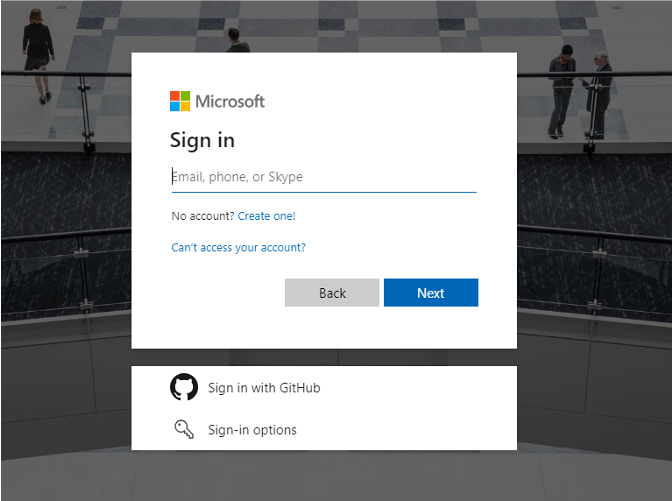

Verify identity

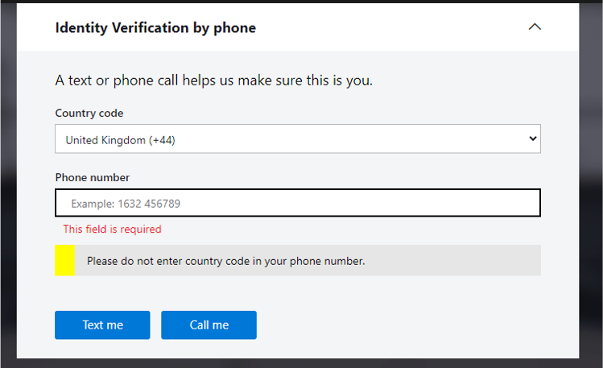

Put your Uni address for verification

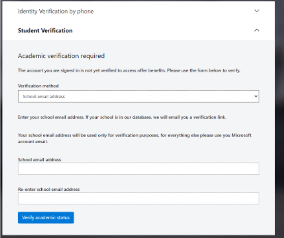

Click on registration link received by email

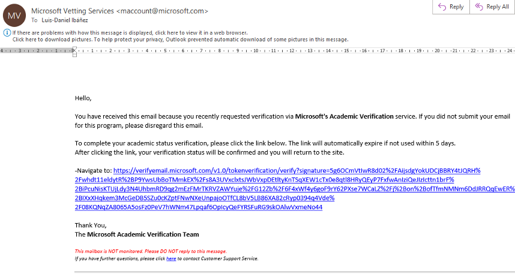

Solve the puzzle

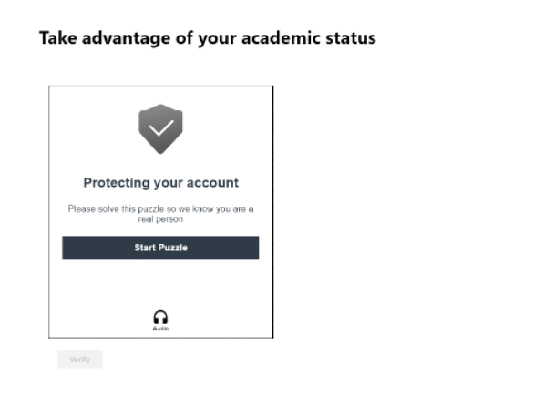

Receive congratulations

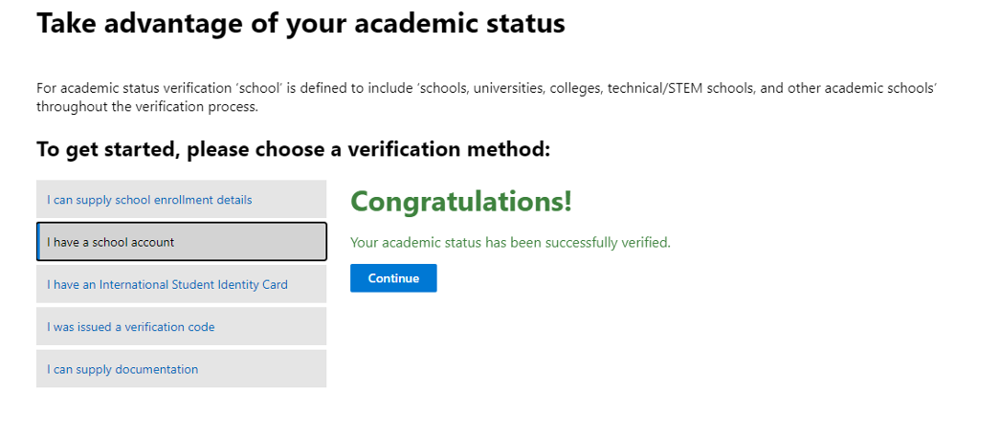

Go to [portal.azure.com](https://portal.azure.com)

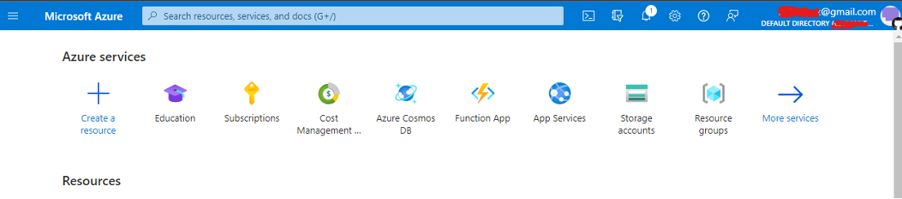

Your personal email should be showing here in the top right corner

Watch out you are logged in with your personal account and not the uni one. It helps to do it on an Incognito browser to avoid picking up the cookie of Uni's O365

Go to "Education" (you may need to search for it on the Search Bar)

You should see summary of the Student Offer

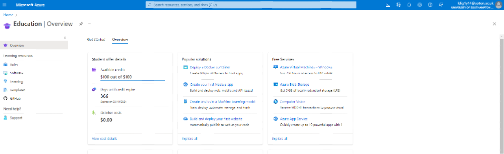

- [ ] Successfully registered new account

## 2. Installing Python

#### Overview

The second part of this lab is to ensure the recommended version of Python is installed onto your computer and made available for use.

These instructions assume basic familiarity with a terminal (macOS/Linux) or PowerShell (Windows).

Our default Python version is 3.13 as this is the version on the lab machines and is supported by Azure Functions.

- Things still work with versions >=3.10 though

We will explain how to work:

- Using your preferred editor to code and execute Azure related commands on the terminal/PowerShell.
- Using MS VS Code, very popular due to good integration with Azure. This runs terminal commands in the background. Understanding the underlying terminal commands will help you develop professional cloud development skills.

If you already have Python setup on your machine then you may skip this step.

### Managing multiple python versions

Some of you may have other versions of Python installed, to make multiple versions co-exist, follow the guides below

* Windows: Follow this guide to see how to use [Python Launcher](https://codemia.io/knowledge-hub/path/how_to_run_multiple_python_versions_on_windows) 
* MacOS: Follow this [guide](https://faun.pub/how-to-install-multiple-python-on-your-mac-d20713740a2d) to install the pyenv tool (up to step 3)
* Linux: Follow this [guide](https://realpython.com/intro-to-pyenv/) to install the pyenv tool

### Install Python

Python is already installed on the Lab PCs.

To install on your own computer:

* Install Python 3.13
* The Python that comes with Anaconda does not play well with Azure, we suggest not playing with it

#### Success Check:

Check Python 3.13 is installed successfully, e.g., example of successful install of an older version of Python in PowerShell

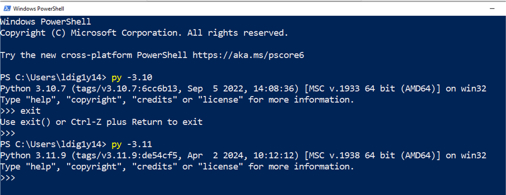

- [ ] Python is installed successfully

## 3. Installing Azure Functions Tools

#### Overview

The third part of this lab is to install the required Azure Tools

You need to have completed the previous steps:

* Account in Azure Portal and active Azure Student Subscription
* Python version 3.13
  * You also need the *pip* program. Win and Mac usually ship it with the base Python install, on Linux you may need to install it separately

### Install Azure-CLI and Azure Core Functions

Both of these are required.

**Azure-CLI:** To manage your account on the terminal and deploy to the Cloud

**Azure Core Functions:** Libraries and runtime to do local development

These are already installed on the lab machines.

Follow the two steps to install onto your own computer:
#### 1. Install Azure Command Line Interface (CLI)

* Follow the instructions [here](https://learn.microsoft.com/en-us/cli/azure/install-azure-cli?view=azure-cli-latest)
* OS-specific instructions inside (latest version is 2.89.1)
* You must be able to invoke the `az` command in your shell/terminal

#### 2. Install Azure Functions Core Tools

- Follow the instructions [here](https://learn.microsoft.com/en-us/azure/azure-functions/functions-run-local?tabs=windows%2Cisolated-process%2Cnode-v4%2Cpython-v2%2Chttp-trigger%2Ccontainer-apps&pivots=programming-language-python#install-the-azure-functions-core-tools)
- OS-specific instructions inside (latest version 4.2.2)
- You must be able to invoke the `func` command in your shell/terminal

##### Success Check

When you run `az version` and `func version` then you should see a success indicator similar to the below (Win Powershell) . Version numbers will likely differ, you should see the version number you installed.

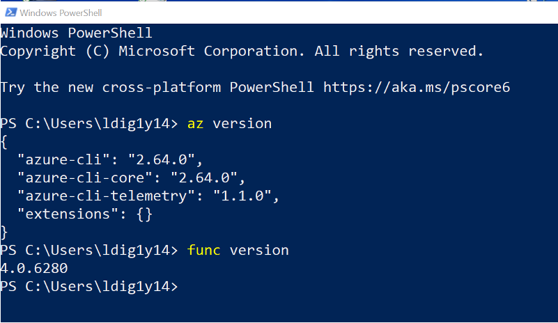

`az account show` should print the details of your account, meaning you are logged in

To logout, input `az logout`

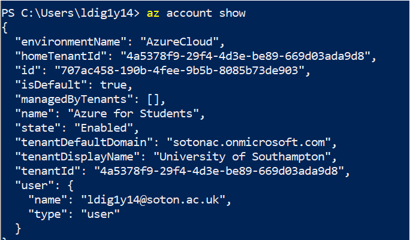

### Test you can access your account

Follow the below (only the sign-in part, we are just testing that )

https://learn.microsoft.com/en-us/cli/azure/get-started-with-azure-cli#sign-into-the-azure-cli

Input `az login` in the terminal and select Azure for Students

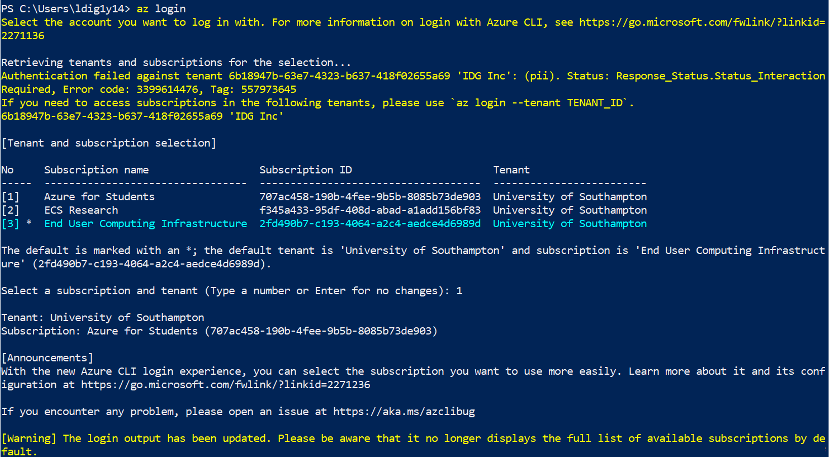

## 4. VS Code

This is an optional part of the lab.

MS Visual Studio Code is a good IDE for developing Azure Functions

Behind the scenes, VSCode runs the commands in the PowerShell/Terminal version of these instructions, so is good you take a look at those to understand what is happening under the hood

### Installing Extensions

The [Python extension](https://marketplace.visualstudio.com/items?itemName=ms-python.python) and the [Azure Functions](https://marketplace.visualstudio.com/items?itemName=ms-python.python) extension should be installed.

- The easiest way to install these is from within VSCode itself
- You may also install the [Azure Tools Extension](https://marketplace.visualstudio.com/items?itemName=ms-vscode.vscode-node-azure-pack), that includes Azure functions and allows managing other parts of your Azure account. However, we will only explain how to manage those from the Web Portal. You are of course welcome to experiment on how to do it with this extension

### Creating Environment

Select the Python environment you want to use in VSCode following these [instructions](https://code.visualstudio.com/docs/python/environments).

If everything is correct from the previous steps, you should be able to choose from the Python versions installed in your system.

### Azure Functions on VSCode

Once the Azure Tools Extension is installed, you will see an Azure icon on the left side of VS Code.

Clicking on this icon shows your Azure cloud resources and local development Function Apps.

To view your cloud resources, you need to sign into your Azure account.

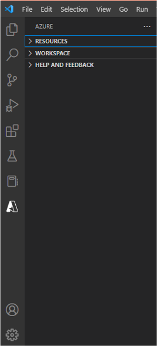

## Lab Completion Checklist

- [ ] I created my Azure Student Account and can access it on the Azure Portal
- [ ] I installed Python 3.13 and can start it from a terminal/PowerShell
- [ ] I installed Azure-CLI and Function Tools, I can invoke `az version` and `func version` commands from the terminal/PowerShell
- [ ] (Optionally) I have setup Python Azure functions on VS Code.
