# COMP3207 - Azure Functions - Lab 3

In this lab, we continue with the `TreeHuggers` example from Lab 2. Now, we begin to develop it for the cloud by writing and deploying Azure functions to run in Azure.

## Lab Goals

By the end of this lab, you will be able to:

1. Create the necessary Azure Cloud resources to host a Function App
1. Deploy locally coded functions to the cloud - Azure Functions

After completing this lab, you should be in a position to start the first individual assignment by creating the local functions and code all input validation tasks. Later, you can add the database connection

## 0. Pre-requisites

* Lab 1 completed. i.e. you have an Azure account and setup your machine
* Lab 2 completed i.e., you have reacquainted yourself with coding in Python and have gained familiarity with the TreeHuggers application
* Lectures on Azure. You know what Resources, Function Apps, and Azure Functions are

## 1. Setting Up MS Azure

You need to setup a resource group and a function app before you can develop and deploy a function app.

Make sure you are logged into https://portal.azure.com

### Create Resource Group

In the search bar at the top of the screen, find resource groups on Azure

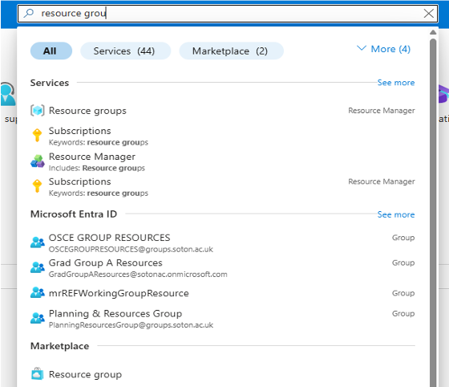

Once you are on the Resource Manager screen, click the + Create button.

Make sure to choose Azure for Students as your subscription.

Enter a resource group name such as treehuggers-2627-youruserid to make it clear this resource group is for this lab (and the next) e.g. treehuggers-2627-vj3g25

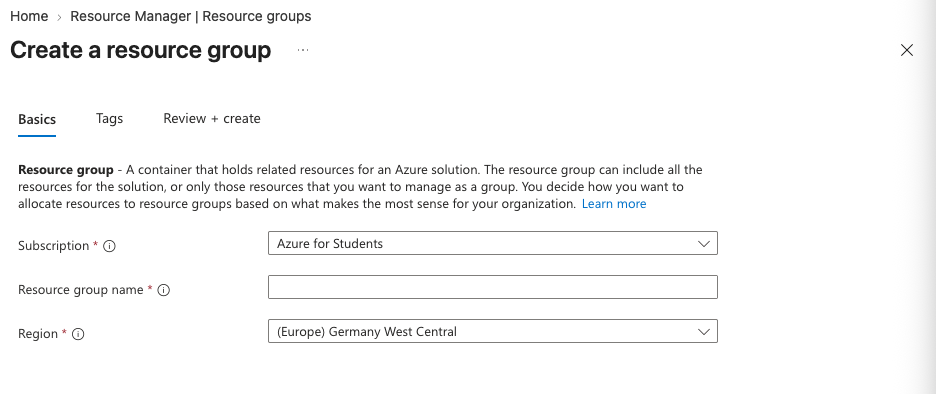

Choose a local region e.g. (Europe) UK South

Then select Review + Create to review the resource group.

Hit Create

You should see a success screen like this

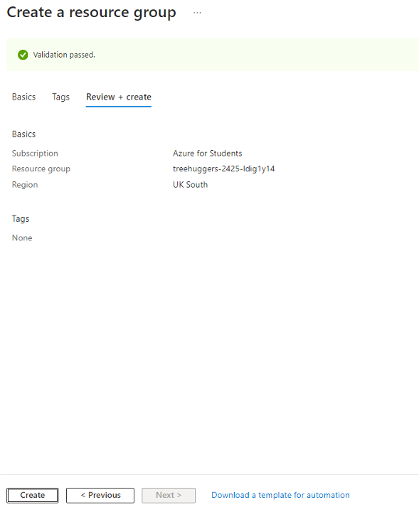

### Create Storage Account

This is needed for the next lab but easier to do now while you are on the Azure website.

(A slight annoyance.....)

To help balance the load on the computers it has across the world, Microsoft limits the regions where the Storage Account of Student Accounts can be deployed. For each account, a different set of locations is deployed. They know that student usage is not very heavy (limited by available credits), so they pay the price in data transfer from UK South (where we are) to whatever location they assigned to us, because they know students are willing to tolerate more latency than regular clients.

The User Interface does not make it clear which storage accounts are available to us. To find this out, there are some additional steps to check:

Go to subscriptions and select Azure for students

Then enter "Policies" in the search bar to get the policy page

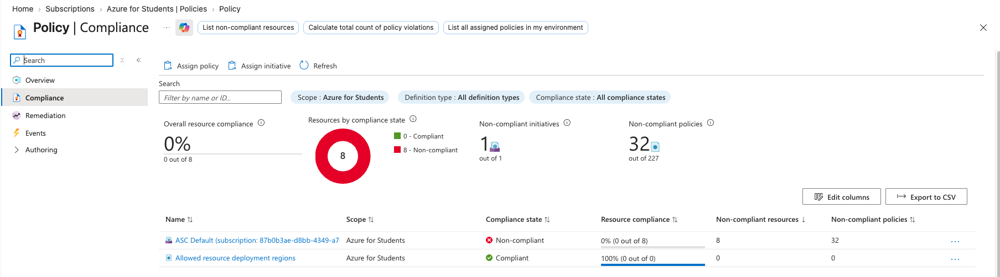

and click on "Allowed resource deployment regions" at the bottom of the screen.

Click on View assignment near the top

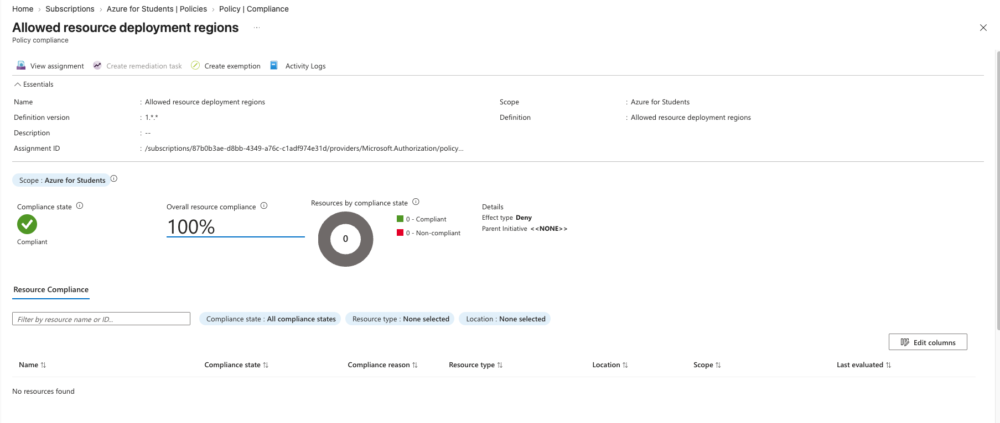

Now you can see what storage locations are available to you at the bottom of the screen under Allowed locations. Choose one of these when you create the storage account.

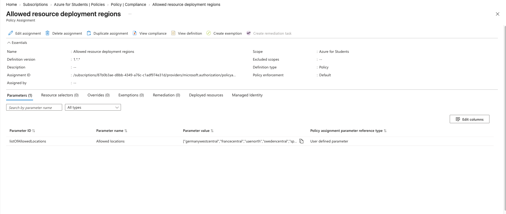

After that, you can now create the storage account from the Azure homepage. Enter storage in the search bar and select Storage accounts

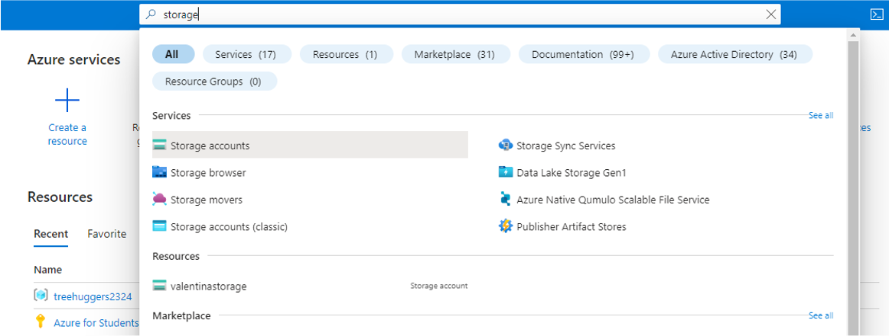

Select "+ Create"

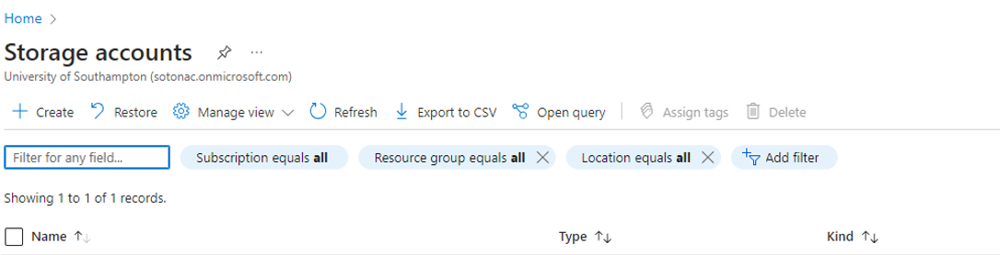

Enter Azure for students as the subscription, select the resource group you just created, enter your storage account name e.g. storagevj3g25. This storage account needs to be unique across Azure, choose a region that is free (see above), for Primary Service choose Other (tables and queues), choose standard performance, choose Locally redundant storage, and default values for everything else. Then hit Review + Create

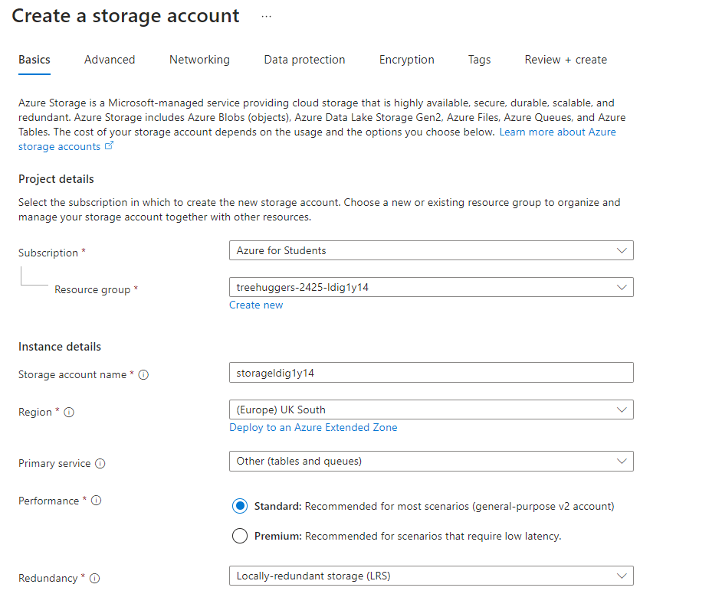

On the review screen, hit Create

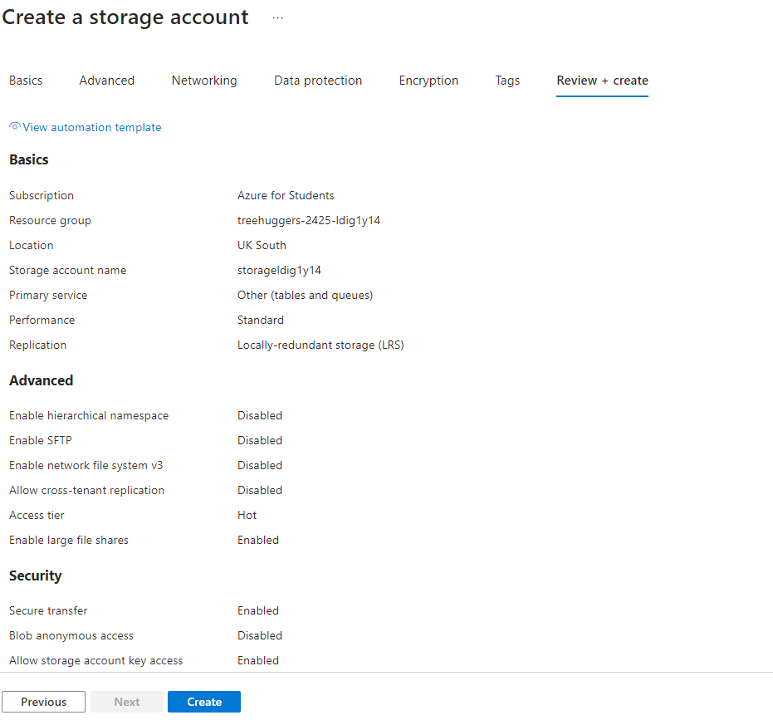

You should see a success screen like this one

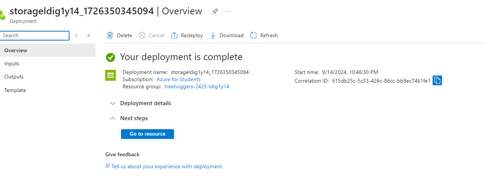

### Create FunctionApp

This is where you will deploy the Azure functions.

Enter functions in the top search bar. Choose Function App under Services. Hit Create.

Choose Flex Consumption

Ensure is Azure for students, select the Resource Group created earlier, enter the URL of the web-app inside the Function App name, this must be globally unique so something like treehuggers-2627-yourstudentid should work, important to select Python, choose the version of Python you are running on your computer (likely 3.13), set instance size to 512 MB, set the region to the one selected for the Storage. Leave the Zone Redundancy as Disabled. Hit Review and Create.

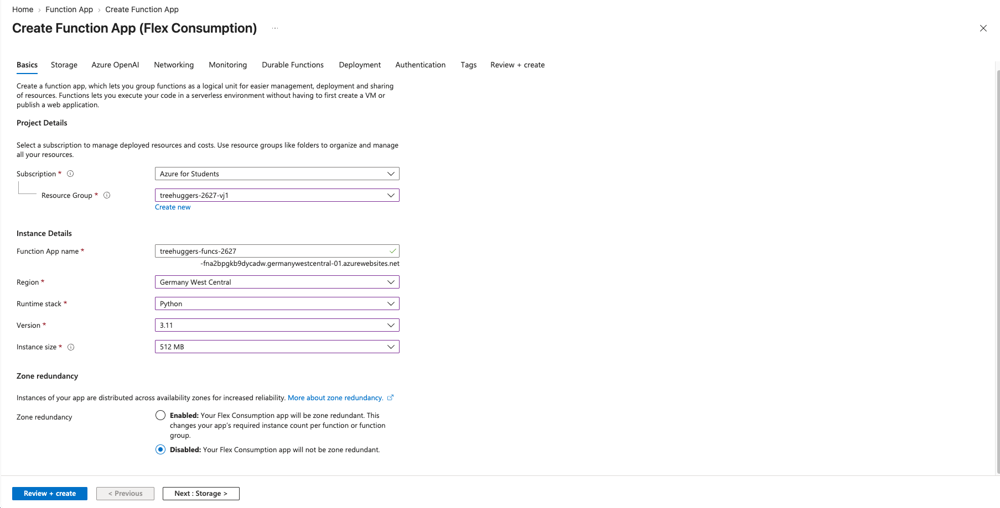

Double check the version of Python is correct, then hit Create

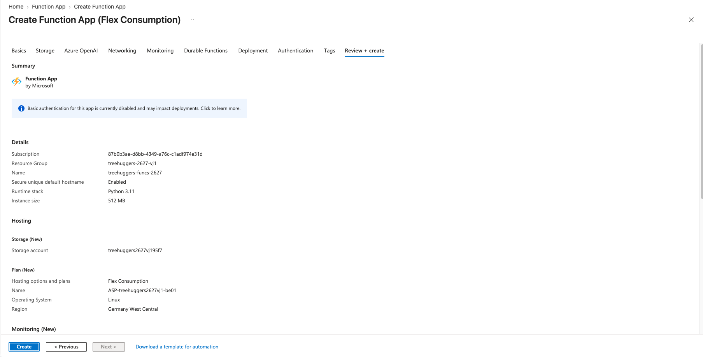

You should then get a success screen like this one. It may take a few minutes.

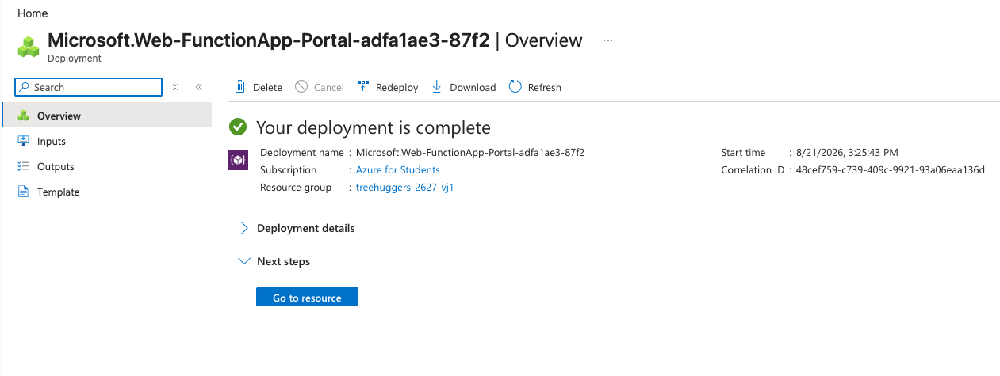

Now you can create, edit, and deploy a FunctionApp.

## 2. Activities

The goals are to:

* create a local development FunctionApp
* create and edit Azure functions into a local development Function App
* Run the Function App locally and test an Azure Function
* Deploy the local development Function App to the Azure cloud using the resources just created.

### Activity 1 - Creating local Functions

#### Setup venv

Create a virtual environment. Ensure this has the same version of Python (3.13) you selected when creating the Azure function app.

Remember to activate this virtual environment before installing azure functions.

Install azure functions using `pip install azure-functions`

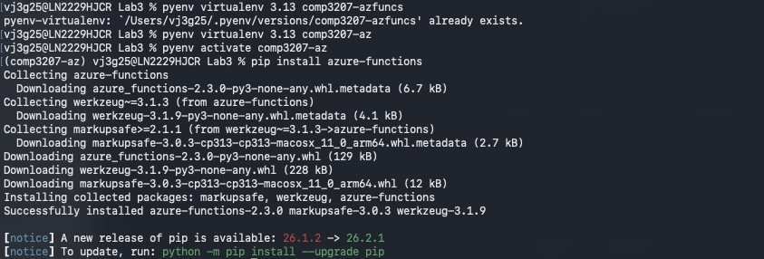

#### Create Function App

Now create the local development Function App. We use the `func` command with the `init` option e.g., `func init TreeHuggers2627 --worker-runtime python`

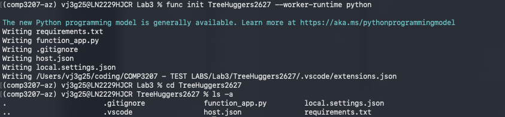

This will create a folder called TreeHuggers2627 and within this some files. Change into this folder and then examine the files. Note the `function_app.py` file and the `host.json` file. The function definitions go in the former file and configurations in the latter.

Now create an Azure function in this local development environment. To do so, make sure you are inside the function app folder (TreeHuggers2627), then enter `func new --name MyFirstFunction --template "HTTP trigger"` When prompted for Auth level, select "Function" as the auth level. We will discuss this later in the lab.

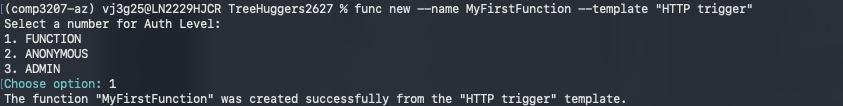

This command creates a function within `function_app.py` following the specified template. Open up `function_app.py` to see it.

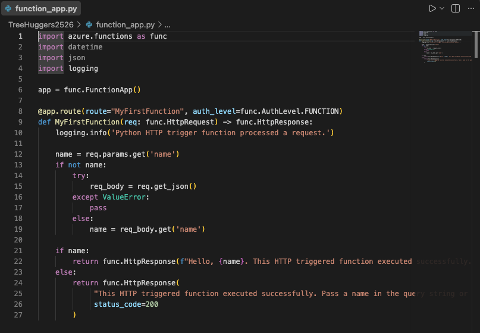

Inspect the created function:

* Take note of how the [HttpRequest](https://learn.microsoft.com/en-us/python/api/azure-functions/azure.functions.http.httprequest?view=azure-python) and [HttpResponse](https://learn.microsoft.com/en-us/python/api/azure-functions/azure.functions.httpresponse?view=azure-python) classes are used
* Note how the parameters from the HttpRequest are accessed
* Modify the responses (line 22 and 25) with messages of your liking.

#### Start Local Development Server

Now start the local development server:

* Use the `func start` command from the root of the FunctionApp (i.e. inside the TreeHuggers2627 folder just created)
* Note that on Windows, the Defender Firewall may complain

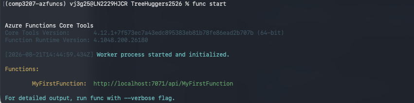

#### Test Local Function App

Now try it out:

* Go to the URL of MyFirstFunction in your browser, this will likely be http://localhost:7071/api/MyFirstFunction if you followed the details above
* You should see the message you wrote inside the MyFirstFunction Python function.
* Troubleshooting: Stop the server with Ctrl-C on the terminal and start again
* Pass parameters to the function by the URL - you should see a different message depending on how you amended the code. See the examples below

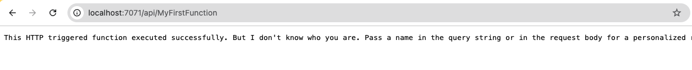

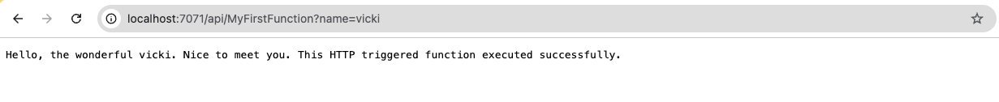

#### Using requests library

Seeing functions working on the browser is reassuring but inefficient for testing.

Open a new terminal, navigate to the `TreeHuggers2627` folder and activate the venv, start a Python interpreter

Make a request to "MyFirstFunction" passing in a name as a parameter (see below). Spot the error I made the first time! Don't repeat it.

Leave the server running and the new terminal open, we will use them later.

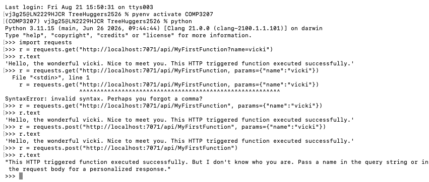

You may get errors about the requests library. In which case, `pip install requests`

### Activity 2 - Amending functions locally

Put the files within the *TreeHuggers* folder in the downloaded zip file into your working folder, i.e. within the TreeHuggers2627 folder you created earlier.

Remember to work on the terminal where you have the virtual environment active

Note that in this code, a function is declared inside the *tree_add* folder. This is another way to declare Azure functions. You can add many functions to the function_app.py file or create a folder per function and write the function to the ``__init.py__`` file.

If you have the *function_app.py* file created earlier as a test function, you can either delete this file or rename it to something else (e.g. *function_app_old.py*). By default, Azure functions picks this up as the function definition file. It only picks up functions inside folders if this *function_app.py* file does not exist.

Inspect the code inside *shared_code*, it's a refactoring of the Tree class from Lab 2.

* Complete Activity 2.1 defined in the code

Inspect the files *tests/test_tree_class.py* and *tests/test_add_tree_function.py*

* Note how the tests use the requests library to assert the correctness of response messages
* Run tests with `python -m unittest` as in Lab 2, you may reuse the terminal you used for the Python interpreter. For example, if you are in the TreeHuggers2627 folder then `python -m unittest tests/*` will run all of the tests. Check out the [unit test library](https://docs.python.org/3/library/unittest.html) for more details on running unit tests.
* Complete activity 2.2 in *test_tree_add_function*

Now let's update the function itself:

* Complete activity 2.3 in method *main* in *\__init__.py* within the *tree_add* folder.

#### Debugging hint

Errors in the function are output as debug information in the local dev server. When the server finds an error, debug info is printed there, as the example below.

You can print your own debugging messages through the "logging" module

To stop the server, press Ctrl-C (or Apple-C) on the terminal running it

You restart it with the same command, you need to do this whenever you add a new function to functions_app.py or change the code.

### Activity 3 - Deployment to Azure

To deploy, you need to tell Azure Functions what libraries you use

Remember, behind the scenes, Microsoft ships and installs your app in many machines

In Python apps, you do this with the `requirements.txt` file in the folder of the FunctionApp

To refresh the list, run the command `pip freeze > requirements.txt` from the root of the FunctionApp (TreeHugger2627 in this case)

To deploy, you need to enter `func azure functionapp publish NAME_OF_FUNCTIONAPP_ON_AZURE` replacing NAME_OF_FUNCTIONAPP_ON_AZURE with the FunctionApp you created on Azure right at the start of the lab.

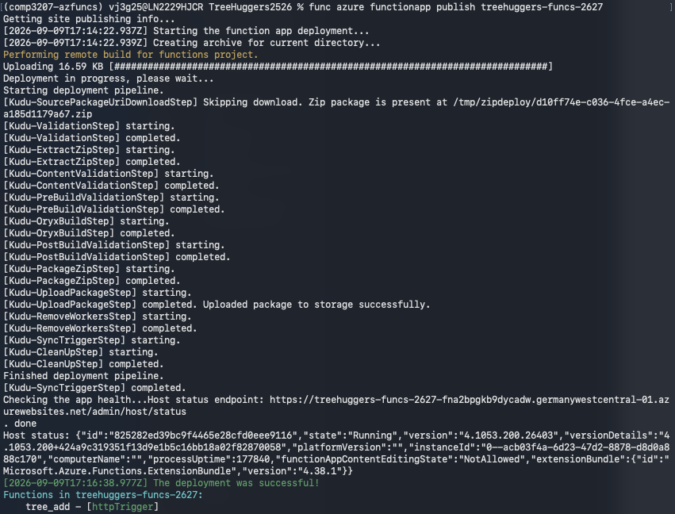

If you get an error in the terminal that mentions Unable to connect to Azure, then you may not be logged in via the Azure CLI. To login, enter `az login` and follow the instructions to login. If you are asked to select a subscription then choose the student account. Once logged in, try the deploy command again

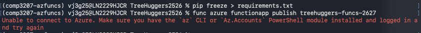

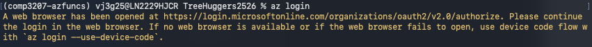

Once it is deployed (it may take a few minutes), the terminal shows you the URL to access the function via a browser. Put this into a browser.

Whoops! You will get an error like this.

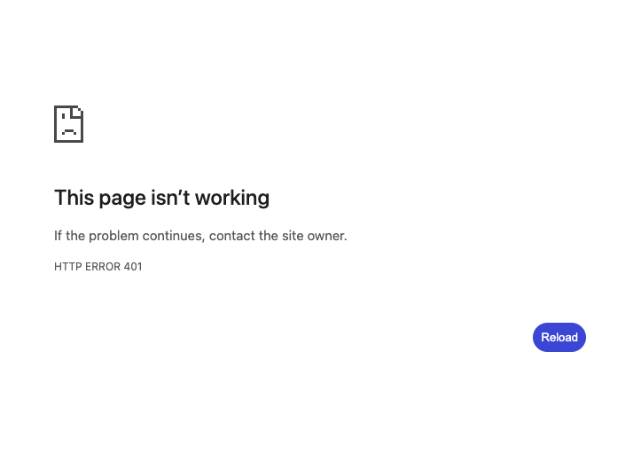

Remember the function was created with a "Function" authorisation level. Local development server ignores this for convenience, deployment does not for security.

You need to get keys. On the FunctionApp page, select App keys on the left hand menu to see the keys

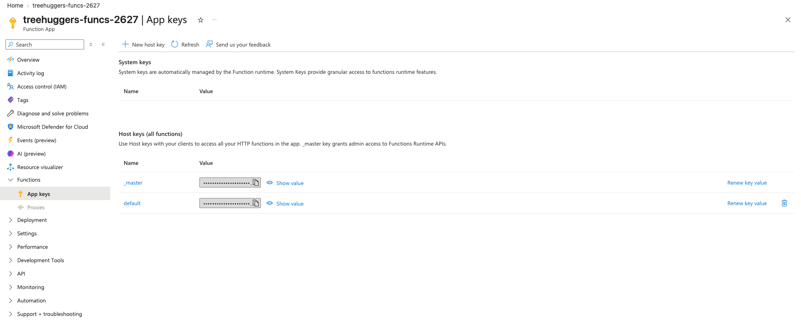

Copy the default host key

#### Fixing Authorisation

Read this piece on [API Authorisation](https://learn.microsoft.com/en-us/azure/azure-functions/functions-bindings-http-webhook-trigger?tabs=python-v1%2Cisolated-process%2Cnodejs-v4%2Cfunctionsv2&pivots=programming-language-python#api-key-authorization) to ensure you understand what is going on

The `test_is_valid_correct` test method has a placeholder for your API key. Put this in.

As a piece of advice, hardcoding keys into your code like this is a VERY BAD IDEA. It can lead to you leaking sensitive keys if it gets checked into source code. At the very least, you should put it into a .env file that is not checked into source code. It is left as an exercise for you to do this. 

If you now access the same URL shown when you published the function and append ?code=API_KEY by replacing API_KEY with the key, ie. the URL should be of the form `https://FUNCTIONAPP/api/tree_add?code=API_KEY` and load the page, you should see some JSON returned.

#### Test Deployment

You test it the same way as localhost.

In *test_tree_add_function.py*, fill the PUBLIC_URL variable with your public URL, then change the TEST_URL to it. Read the code comments to see how to pass the API key in the request.

Run tests, they should pass.

#### Debugging Deployment

If you get errors then you can look at the logs in Azure.

Click the Logs link under the Monitoring link on the left hand side. You can see a bunch of tables containing different log entries. If you select exceptions, you can see exceptions raised by Azure. 

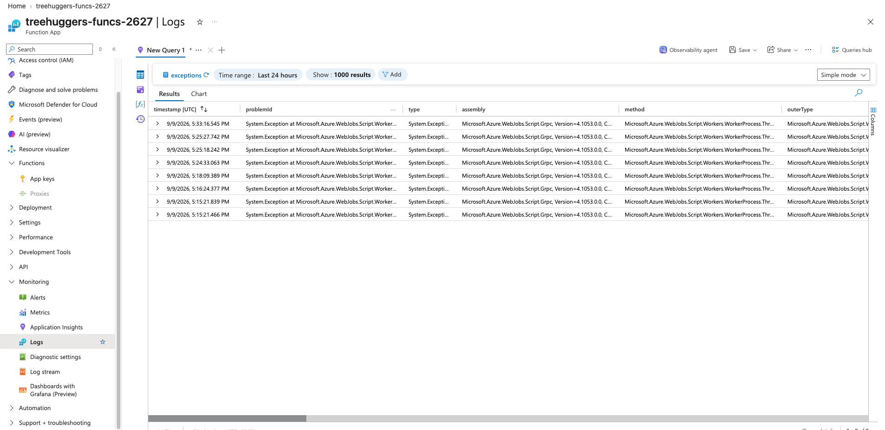

Keep in mind that it might take a few minutes to become available.  Also, sometimes you need to refresh the whole tab instead of using the refresh link in this panel.

Here you have details of what happened. The most common errors are:

1. Forgot to add a module to the requirements.txt
2. Misconfiguration of DB credentials (we will see in the next lab)
3. Common programming errors, these should be detected when testing on the local development server.

A common error is forgetting to refresh the list of requirements

To refresh the list, run the command `pip freeze > requirements.txt`

Redeploy the app (same command to deploy) and test again

Success

Success???

Remember we assumed *tree_add* receives valid json, so we did nothing in that case, and by clicking the URL we just passed an empty request.....

It is good practice in *HttpResponse* out functions to return something at the end to help us identify flows we did not consider. Do this on your own. And retry the deployment and visiting via the browser.

#### Final Configuration

Read this part on [Customising HTTP endpoint](https://learn.microsoft.com/en-us/azure/azure-functions/functions-bindings-http-webhook-trigger?tabs=python-v1%2Cisolated-process%2Cnodejs-v4%2Cfunctionsv2&pivots=programming-language-python#customize-the-http-endpoint) and modify the route of *tree_add* function so it can be accessed at the path /tree/add

Update the methods array to make *tree_add* accept only POST requests. Refactor *test_tree_add_function.py* to use *requests.post* instead of *requests.get*

### Activity 4 - Consuming an Azure cloud service

DO NOT DO THIS PART. FOR SOME REASON, MICROSOFT IS NOT LETTING STUDENT ACCOUNTS USE THIS Azure MAP SERVICE EVEN THOUGH IT CAN BE USED IN A LIMITED CAPACITY FOR FREE.

In the earlier lab, we used nominatim's API to implement the *get_address* method, but usage policy is quite limited.

In this activity, we refactor it to scale using the cloud service Azure Maps.

You are encouraged to use other Azure services for your group project.

Refactor *Tree.get_address* to use Azure Map' Search Address Reverse instead of Nominatim.

* Hint: Take notice of the difference between a path parameter and a query parameter

We still require the Tree address to be a single string with comma separated values of address components as in the test case.

* Geolocation from Azure Maps is slightly different. Replace '85' with '83' in the mock tree address

## VS Code Hints

Unsurprisingly, VS Code has strong integration with MS Azure. You can use VS Code to create new functions, test them locally, and deploy to Azure.

MS have extensive information on this [integration](https://learn.microsoft.com/en-us/azure/azure-functions/functions-develop-vs-code?tabs=node-v4%2Cpython-v2%2Cisolated-process%2Cquick-create&pivots=programming-language-python).

### Azure Functions on VS Code

The Microsoft developer guide says that when you create a new Function, you are prompted to create a new Project. But that's only true if you don't have a current project.

A cleaner way is to invoke VSCode's "Command Palette" with Ctrl-Shift-P (in Windows)

* Select a folder for the project
* Select Python as a language
* Select a Python version to create a virtual environment for your project
* Choose a template for your first function e.g., HTTP Trigger for this lab
* Enter the function name
* Choose the authorisation level

What we've done here is the same as we did in the terminal

* Create a virtual environment
* func init to create FunctionApp local development folder
* func new to create Azure function inside Function App local dev

### VSCode - Installing Python libraries

When you start a terminal in your project, it automatically activates the venv we created for it

To start the development server, simply press 'F5', this runs func start behind the scenes

You can then run the unit tests on the terminal within VSCode attached to your project (that has the venv active)

### VSCode - Deployment

To deploy, you will need to log into MS Azure first.

You can click the local function to deploy. You will be prompted to select a FunctionApp created in the Azure Cloud. Select the one you created at the beginning of the lab.

## End of Lab Checklist

By the end of this lab, you should have completed the following:

- [ ] Setup Azure Resources, Storage, and Functions
- [ ] Completed Activity 1 - Setup local Azure Function
- [ ] Completed Activity 2 - Amended local function
- [ ] Completed Activity 3 - Deployed function to the cloud

You can now start the first coursework. You cannot complete the database part of it until the next lab has been completed.

